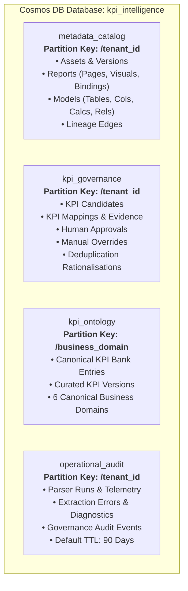
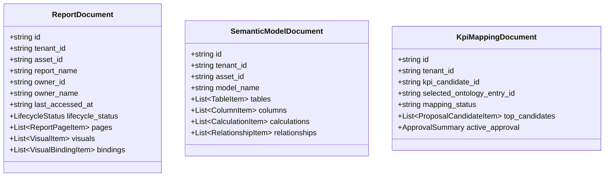

# Azure Cosmos DB for NoSQL — Canonical Data Model Architecture & Local SQLite Validation

## 1. Executive Summary & Design Rationale

KPI Intelligence is a universal enterprise metadata extraction, KPI ontology mapping, human governance, and lifecycle rationalisation platform. This document establishes the production-native canonical architecture based on **Azure Cosmos DB for NoSQL as the sole production storage engine**, paired with a **local SQLite database adapter** for offline developer inspection, automated testing, and repeatable local validation.

### Why Cosmos DB for NoSQL?
1. **Globally Distributed Multi-Tenancy**: Cosmos DB provides partition-key-driven multi-tenant isolation, sub-10ms point-reads, and linear elasticity without relational table locking or sharding bottlenecks.
2. **Document Aggregate Boundaries**: Power BI PBIP and enterprise BI projects represent deep hierarchical trees (reports contain pages; pages contain visuals; visuals contain data bindings; semantic models contain tables, columns, measures, and relationships). In a relational model, retrieving a single dashboard required joining over 12 tables. In Cosmos DB, the report and semantic model are persisted as cohesive document aggregates, slashing write transactions and providing atomic read access.
3. **Flexible Schema Evolution**: BI platform definitions continuously evolve (e.g. Power BI TMDL features, Fabric metadata extensions, DAX expression enhancements). Document storage natively handles JSON polymorphism without disruptive DDL database migrations.
4. **Predictable Performance & SLAs**: Serverless and Autoscale RU/s provisioning guarantees throughput SLAs for concurrent tenant workloads while eliminating cross-tenant database resource starvation.

---

## 2. Container Catalogue & Partitioning Strategy

The production physical architecture consolidates the legacy 61-table relational schema into **four specialized Cosmos DB NoSQL containers**:



### Detailed Container Specifications

| Container Name | Partition Key | Default TTL | Document Types | Target Sizing / Access Pattern |
| :--- | :--- | :--- | :--- | :--- |
| `metadata_catalog` | `/tenant_id` | -1 (Off) | `asset`, `asset_version`, `report`, `semantic_model`, `spreadsheet_workbook`, `lineage_edge` | High read, moderate write; single-partition queries by tenant and asset version. |
| `kpi_governance` | `/tenant_id` | -1 (Off) | `kpi_candidate`, `kpi_mapping`, `mapping_approval`, `mapping_override`, `kpi_rationalisation`, `domain_classification`, `metadata_field_review` | High write during discovery and review; transactional approval state transitions. |
| `kpi_ontology` | `/business_domain` | -1 (Off) | `ontology_entry`, `ontology_version`, `business_domain`, `platform_capability` | Read-heavy reference data shared globally across tenants; partitioned by domain. |
| `operational_audit` | `/tenant_id` | -1 (On with doc TTL) | `parser_run` (90d), `extraction_error` (90d), `audit_event` (permanent), `ingestion_event` (permanent), `ontology_change_event` (permanent) | High-churn diagnostics auto-purged at 90 days; immutable governance audit records preserved permanently with `ttl = -1`. |

### Partition Key Justifications & Hot Partition Mitigation
1. **`/tenant_id` on `metadata_catalog`, `kpi_governance`, and `operational_audit`**:
   - *Colocation*: All queries for a tenant (e.g. "List active reports for Tenant Alpha", "Show pending mappings for Tenant Beta") execute as single-partition queries, avoiding expensive cross-partition query fan-out.
   - *Physical Isolation*: Azure Cosmos DB automatically manages partition placement. High-activity tenants scale across physical partitions independently without impacting other tenants.
   - *Volume Distribution*: Each tenant partition typically stores 1,000 to 50,000 documents (< 2 GB), remaining well below the 50 GB physical partition threshold.
2. **`/business_domain` on `kpi_ontology`**:
   - Curated reference KPIs are global (shared across all tenants).
   - Partitioning by the 6 canonical business domains (`CLAIMS_RISK`, `UNDERWRITING`, `LEGAL`, `FINANCE`, `OPERATIONS`, `GENERAL`) and `SYSTEM` ensures even load distribution and fast partition-scoped retrieval during mapping inferences.

---

## 3. Relational-to-Document Boundary Mapping

In the prior PostgreSQL schema, 61 normalized tables modeled fine-grained metadata components. In Cosmos DB, components with strict lifecycle co-dependence are embedded directly within document aggregates:



### Aggregate Mapping Breakdown
- **Embedded inside `ReportDocument`**:
  - `canonical_report_page`: Embedded as array of page items.
  - `canonical_visual`: Embedded within page items.
  - `canonical_visual_binding`: Embedded within visual items.
  - `canonical_bookmark`: Embedded array within the report document.
- **Embedded inside `SemanticModelDocument`**:
  - `canonical_data_table`: Embedded table definitions.
  - `canonical_data_column`: Embedded column definitions grouped under tables.
  - `canonical_calculation`: Embedded DAX measures and calculation items.
  - `canonical_relationship`: Embedded relationship definitions (from/to table, cardinality, cross-filtering).
  - `canonical_model_partition`: Embedded table partitions and source expressions.
  - `canonical_named_expression`: Embedded Power Query (M) parameters and expressions.
- **Embedded inside `KpiMappingDocument`**:
  - `mapping_proposal_candidate`: Stored as the ranked array `top_candidates` with semantic match scores and evidence.
  - `mapping_approval` (Active Summary): Snapshot of the active approval embedded in the mapping document for instant resolution without joins.

---

## 4. Multi-Tenant Isolation Architecture

### Removal of PostgreSQL Session State & RLS
In the prior PostgreSQL design, multi-tenancy relied on `set_config('kpi_intel.current_tenant_id', ...)` and Row-Level Security (RLS) policies. This model posed security risks in connection-pooled web backends where connection leaks or misconfigured transactions could bleed tenant state.

### Trusted Application-Tier Enforcement (Fail-Closed)
In the Cosmos DB architecture, tenant isolation is enforced through **`TenantContext`** at the application and repository layer:
1. Every domain repository method mandates a valid, strongly-typed `TenantContext(tenant_id=...)`.
2. Every document read, upsert, or query validates that the document's `tenant_id` strictly matches `TenantContext.tenant_id` via `assert_authorized()`.
3. If an operation attempts to target an unauthorized tenant partition, a `TenantAccessDeniedError` is immediately raised before any data is processed or returned.
4. Physical partitioning on `/tenant_id` guarantees that queries scoped to a partition key physically cannot access data from another tenant in the Cosmos storage fabric.

---

## 5. Concurrency Control & Throttling Resilience

### 1. Optimistic Concurrency Control (ETags / HTTP 412)
- All documents carry an `_etag` field assigned by the database engine.
- On updates, callers can specify an `etag` condition (`IfMatch: "<etag>"`).
- If another process updated the document concurrently, Cosmos DB returns `HTTP 412 (Precondition Failed)`.
- The repository layer catches HTTP 412 and raises `ConcurrencyConflictError`, allowing callers to retry or report conflicts cleanly.

### 2. HTTP 429 Rate Limiting Backoff & Retry
- Azure Cosmos DB enforces Request Unit (RU/s) limits. If instantaneous demand exceeds provisioned capacity, the service returns `HTTP 429 (Request Rate Too Large)`.
- `CosmosRepository._execute_with_retry` automatically intercepts HTTP 429 responses:
  - Inspects the `x-ms-retry-after-ms` response header.
  - Pauses execution for the requested duration (or applies exponential backoff with jitter: $500\text{ms} \times 2^{\text{attempt}-1}$).
  - Retries up to `cosmos_max_retries` (default: 5).
  - If retries are exhausted, raises `ThrottlingError(retry_after_ms=...)`.

---

## 6. Local SQLite Validation & Developer Tooling

To ensure zero cloud cost and full offline developer productivity, the repository provides an interchangeable SQLite storage adapter (`backend/storage/sqlite/repository.py`):

### SQLite / Cosmos Parity
- Documents are stored as JSON blobs in a unified `cosmos_documents` table:
  ```sql
  CREATE TABLE cosmos_documents (
      container_name TEXT NOT NULL,
      partition_key TEXT NOT NULL,
      document_id TEXT NOT NULL,
      tenant_id TEXT,
      document_type TEXT NOT NULL,
      schema_version TEXT NOT NULL,
      etag TEXT NOT NULL,
      document_json TEXT NOT NULL,
      created_at TEXT NOT NULL,
      updated_at TEXT NOT NULL,
      PRIMARY KEY (container_name, partition_key, document_id)
  );
  ```
- Queries using Cosmos SQL syntax are translated dynamically to SQLite parameterized queries utilizing `json_extract()`.
- Optimistic concurrency, ETags, continuation-token pagination, and fail-closed tenant boundary enforcement are identically supported.

### Critical Production Safety Guard
To guarantee SQLite is never accidentally invoked in production or staging:
```python
if app_env in (AppEnvironment.PRODUCTION, AppEnvironment.STAGING) and backend_type == StorageBackendType.SQLITE:
    raise RuntimeError(
        f"FATAL CONFIGURATION ERROR: KPI_STORAGE_BACKEND is set to 'sqlite' in {app_env.value} environment. "
        "SQLite is strictly prohibited in production and staging environments."
    )
```

### Local CLI Commands
```bash
# Initialize all 61 canonical relational tables + Cosmos store with synthetic seed records
python -m backend.storage.cli init --all --seed

# Initialize only the 61 canonical relational tables with seed records
python -m backend.storage.cli init --relational --seed

# Initialize only the Cosmos document emulation store with seed records
python -m backend.storage.cli init --cosmos --seed

# Validate relational schema completeness (61 tables, 636 columns) and foreign key integrity
python -m backend.storage.cli validate --relational

# Inspect database contents (relational tables by subsystem + Cosmos documents breakdown)
python -m backend.storage.cli inspect --all

# Inspect relational tables breakdown
python -m backend.storage.cli inspect --relational

# Inspect Cosmos containers and document types
python -m backend.storage.cli inspect --cosmos

# Export relational tables to JSON bundle
python -m backend.storage.cli export --relational --output local_data/relational_export.json

# Reset local database
python -m backend.storage.cli reset --all --force
```

---

## 7. Migration & Reconciliation Strategy

The repository includes `scripts/migrate_postgres_to_cosmos.py` to seamlessly migrate legacy relational databases to Cosmos DB (or local SQLite):
- Operates either against a live PostgreSQL database via `psycopg2` or offline from exported JSON dumps.
- Aggregates parent/child components into Cosmos document structures.
- Generates a real-time reconciliation report verifying:
  - Source relational rows vs. target Cosmos documents.
  - Total embedded elements (pages, visuals, tables, columns, measures).
  - 0 orphan child components.

---

## 8. Infrastructure as Code & RBAC Deployment

Production provisioning artifacts are provided in `infra/cosmos/`:
- **`infra/cosmos/containers.json`**: Declarative specification of containers, partition keys, selective indexing policies, and default TTLs.
- **`infra/cosmos/cosmos.bicep`**: Enterprise Bicep template provisioning the Cosmos DB account, database, containers, and RBAC role assignments (`Cosmos DB Built-in Data Contributor`).
- **`scripts/provision_cosmos.py`**: Automated, idempotent Python provisioning tool using the `azure-cosmos` SDK.
