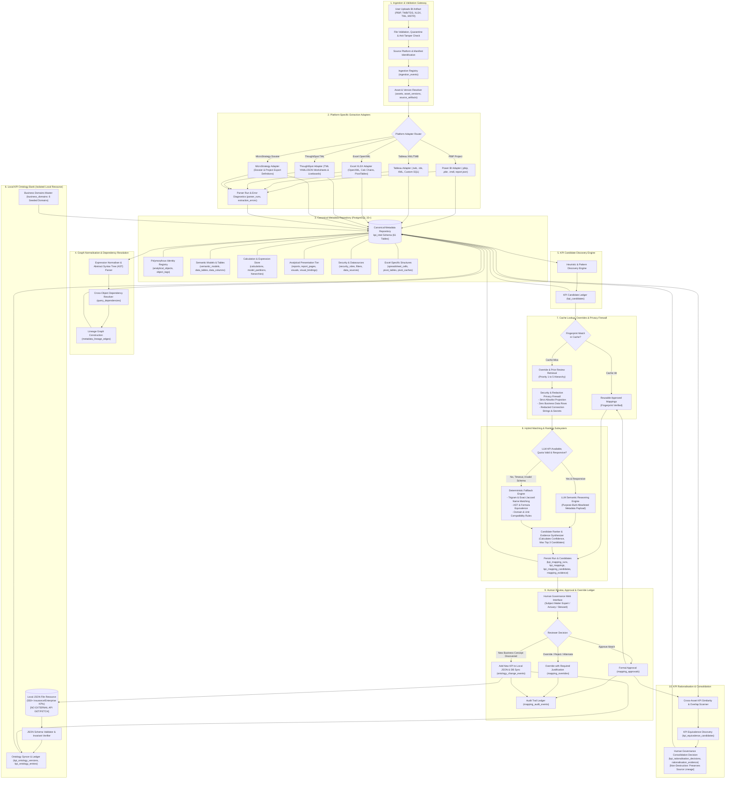

# KPI Intelligence — End-to-End Canonical System Architecture

## 1. Executive Summary & Architectural Mission

The **KPI Intelligence Platform** is an enterprise-grade metadata extraction, ontology mapping, human governance, and KPI rationalisation platform. It addresses the systemic problem of KPI sprawl, duplicate metric definitions, calculation drift, and untracked semantic fragmentation across five major enterprise Business Intelligence (BI) platforms:
1. **Power BI** (PBIP format strictly)
2. **Tableau** (TWB, TDS, packaged TWBX/TDSX manifests)
3. **Excel** (XLSX format strictly)
4. **ThoughtSpot** (TML export packages)
5. **MicroStrategy** (Dossier and project export packages)

The platform unifies heterogeneous BI ecosystems into a single, canonical PostgreSQL repository (`kpi_intel` schema) preserving native source expressions (DAX, Tableau calcs, Excel formulas, M/Power Query, SQL), parsed ASTs, visual bindings, lineage graphs, and governance history.

---

## 2. End-to-End System Architecture Diagram



---

## 3. Detailed Component Breakdown & Invariant Rules

### 3.1 Tier 1: Ingestion & Validation Gateway
1. **File Upload & Validation**:
   - The user or scheduled pipeline initiates an upload of one or more BI project packages.
   - Files are validated against strict format signatures. **Power BI .pbix binaries are strictly rejected**; only developer-mode `.pbip` folder structures (containing `.pbir`, `.tmdl`, and `definition.pbir`) are admitted.
   - Excel workbooks must be strict valid `.xlsx` (OpenXML standard); legacy `.xls` or macro-enabled `.xlsm` are quarantined.
   - Computes four distinct non-colliding hashes:
     * **Raw content hash** (`raw_content_hash`): SHA-256 over raw binary payload.
     * **Canonical package hash** (`content_hash`): Normalised archive hash excluding OS metadata.
     * **Structural hash** (`structure_hash`): Normalized schema/AST fingerprint ignoring cosmetic formatting.
     * **Metadata hash** (`metadata_hash`): Digest of semantic identifiers, expressions, and model bindings.
2. **Ingestion Registry (`ingestion_events`)**:
   - Every physical upload attempt creates an immutable `ingestion_events` entry with user identity, filename, upload size, and source.
   - If a re-uploaded file matches an existing `content_hash`, the event references the existing `asset_version_id` without duplicating metadata rows.
3. **Asset & Version Resolver (`assets`, `asset_versions`, `source_artifacts`)**:
   - Resolves the logical asset container (`assets`).
   - If contents changed, increments `version_number` and creates an immutable snapshot in `asset_versions`.
   - Records every contained file in `source_artifacts` (e.g. `definition.pbir`, `model.tmdl`, `document.xml`).

### 3.2 Tier 2: Platform-Specific Extraction Adapters
Each adapter operates under a contract of zero information loss and isolation:
1. **Power BI PBIP Adapter**:
   - Parses PBIP report definitions (`definition.pbir`, page configurations, visual containers).
   - Traverses TMDL (Tabular Model Definition Language) files to extract Tabular models, partitions, relationships, calculation groups, perspectives, hierarchies, and DAX measures.
   - Extracts M/Power Query expressions and connection summaries.
2. **Tableau Adapter**:
   - Parses XML schemas of workbooks (`.twb`) and datasources (`.tds`).
   - Extracts calculated fields, LOD expressions (`{FIXED ...}`), parameters, sets, groups, shelves, dashboard layout trees, actions, and custom SQL queries.
3. **Excel XLSX Adapter**:
   - Parses OpenXML workbook parts (`xl/workbook.xml`, `xl/worksheets/sheet*.xml`).
   - Extracts cell formulas, named ranges (`xl/definedNames`), PivotTables (`xl/pivotTables/pivotTable*.xml`), Pivot Caches (`xl/pivotCache/pivotCacheDefinition*.xml`), and Power Query mashup data.
   - **Crucial Rule**: Does not execute Excel calculation engine; cached formula values are treated as potentially stale display snapshots.
4. **ThoughtSpot TML Adapter**:
   - Parses ThoughtSpot Modeling Language YAML/JSON files for worksheets, tables, liveboards, and answers.
   - Captures formula syntax, aggregate formulas, join paths, and RLS rules.
5. **MicroStrategy Adapter**:
   - Parses Dossier and project JSON/XML export packages.
   - Extracts metrics, compound metrics, attributes, facts, hierarchies, prompts, and security filters.
6. **Parser Run & Error Handling (`parser_runs`, `extraction_errors`)**:
   - Extraction execution is logged in `parser_runs`.
   - Any parsing anomalies, unsupported visual types, or corrupted sub-artifacts generate structured diagnostics in `extraction_errors` with severity (`INFO`, `WARNING`, `ERROR`, `FATAL`) and locator coordinates (`object_locator`).

### 3.3 Tier 3: Canonical Metadata Repository (`kpi_intel`)
All platform-specific abstractions are projected into a unified polymorphous schema:
- **`analytical_objects`**: Central identity table. Every report, page, visual, semantic model, table, column, calculation, filter, and data source receives a stable canonical `object_id`.
- **Specialized Subsystems**:
  * Presentation: `reports`, `report_pages`, `visuals`, `visual_bindings`, `visual_properties`, `visual_interactions`, `bookmarks`, `report_navigation`.
  * Semantic Model: `semantic_models`, `data_tables`, `data_columns`, `calculations`, `relationships`, `model_partitions`, `hierarchies`, `hierarchy_levels`, `parameters`, `named_expressions`.
  * Security & Sources: `filters`, `filter_assignments`, `security_roles`, `security_role_filters`, `security_principals`, `security_object_permissions`, `data_sources`, `query_dependencies`.
  * Excel-Specific: `spreadsheet_cells`, `pivot_caches`, `pivot_tables`, `pivot_field_assignments`, `spreadsheet_objects`, `spreadsheet_rules`.

- **Dashboard Ownership & Lifecycle Governance (`reports`, `v_dashboard_lifecycle`)**:
  * Dashboard entities in `reports` maintain verified ownership (`owner_id` FK -> `security_principals`, `owner_name`), runtime access history (`last_accessed_at` TIMESTAMPTZ), and canonical lifecycle status (`lifecycle_status`).
  * **Classification Precedence**:
    1. `ORPHANED`: `owner_id IS NULL`.
    2. `UNCLASSIFIED`: `owner_id IS NOT NULL AND last_accessed_at IS NULL`.
    3. `DORMANT`: `owner_id IS NOT NULL AND last_accessed_at <= (CURRENT_TIMESTAMP - INTERVAL '6 months')`.
    4. `ACTIVE`: `owner_id IS NOT NULL AND last_accessed_at > (CURRENT_TIMESTAMP - INTERVAL '6 months')`.
  * **Calendar Arithmetic**: Uses native PostgreSQL `INTERVAL '6 months'` with leap-year and variable month length clamping (never a 180-day approximation).
  * **Automated Maintenance**: Synchronized on insert/update via `trg_reports_lifecycle_status` and available for scheduled re-indexing via `refresh_report_lifecycle_status(:tenant_id, :as_of)`.
  * **Downstream Reporting**: Exposed through `v_dashboard_lifecycle` with fail-closed Row Level Security.
  * **Source Boundary**: Power BI Desktop (`.pbip`) files are developer artifacts containing definitions but zero runtime view logs. Runtime access history is reserved for Power BI Service Activity Events API / Unified Audit Log ingestion.

### 3.4 Tier 4: Normalisation & Lineage Graph
1. **Expression Normalisation (`calculations`)**:
   - Original calculation expressions are preserved verbatim in `expression_text`.
   - Expressions are parsed into Abstract Syntax Trees (`expression_ast`) and normalised (`normalised_expression`) by stripping whitespace, standardising casing, resolving column aliases, and expanding implicit model references.
2. **Lineage Edge Resolution (`metadata_lineage_edges`)**:
   - Directed acyclic graph (DAG) construction linking source fields -> calculations -> visual bindings -> report pages.
   - Records `derivation_method` (`PARSED`, `SOURCE_DECLARED`, `INFERRED`, `MANUAL`), confidence score, and supporting JSON evidence.

### 3.5 Tier 5: KPI Candidate Discovery Engine
1. **Discovery Rules (`kpi_candidates`)**:
   - Identifies high-signal analytical constructs (measures with aggregation, visual cards displaying solitary KPIs, calculated columns with financial/operational formulas, named summary cells).
   - Generates a candidate with canonical name, raw and normalised expressions, unit, aggregation type, and domain classification.
   - Associates full discovery evidence in `candidate_evidence`.

### 3.6 Tier 6: Local KPI Ontology Bank (Isolated Local Resource)
1. **Local Storage Contract**:
   - The KPI Ontology Bank contains ~550+ curated industry-standard KPIs (Claims & Risk, Underwriting, Legal, Actuarial, Sales & Distribution, Service Operations).
   - **MANDATORY INVARIANT**: The ontology is stored strictly as a local JSON file within the application container. **NO external API GET/FETCH calls are permitted.**
2. **Schema Validation & Database Synchronization (`kpi_ontology_versions`, `kpi_ontology_entries`)**:
   - Validated against its JSON Schema upon loading.
   - Content digest is verified against `content_hash`.
   - Active version is recorded in `kpi_ontology_versions` (enforced to exactly one active version via a PostgreSQL unique partial index).
   - Every individual KPI is mirrored into `kpi_ontology_entries`, while preserving the exact original JSON payload in `ontology_payload` (JSONB) for auditability.
3. **Business Domains (`business_domains`)**:
   - Contains the 6 seeded immutable business domains: `CLAIMS_RISK`, `LEGAL`, `UNDERWRITING`, `SALES_DISTRIBUTION`, `SERVICE_OPERATIONS`, `ACTUARIAL`.

### 3.7 Tier 7: Cache Lookup, Overrides & Privacy Firewall
1. **Multi-Input Cache Fingerprinting**:
   - Cache key is computed from:
     $$\text{Key} = \text{SHA256}(\text{Candidate AST} \parallel \text{Dependencies} \parallel \text{Ontology Version} \parallel \text{Engine Version} \parallel \text{Prompt Version})$$
   - Cache hits immediately return previously verified mappings without invoking inference.
2. **Override Retrieval Hierarchy**:
   When evaluating a candidate, prior human overrides are retrieved using a strict priority order:
   - *Priority 1*: Exact match on `(asset_id, source_native_id)`.
   - *Priority 2*: Exact match on candidate formula/structure fingerprint.
   - *Priority 3*: High-confidence normalized name and expression equivalence.
   - *Priority 4*: Previous approved mappings for the same semantic entity.
   - *Priority 5*: Full-text and trigram search across `normalised_justification`.
3. **Security & Redaction Privacy Firewall (Critical Security Boundary)**:
   - **ZERO Business Data Rows**: No table rows, customer records, or metric values are ever forwarded to the LLM.
   - **Credential Redaction**: Connection strings, server IPs, database names, and passwords in `data_sources` are replaced with sanitised tokens (`[REDACTED_SERVER]`).
   - **Allowlist Projection**: Only purpose-built, allowlisted metadata is compiled into the inference prompt:
     * Candidate name and description.
     * Normalized calculation expression and aggregation type.
     * Bound visual title and axis role (if applicable).
     * Classified business domain.
     * Subset of ontology candidate definitions for semantic matching.

### 3.8 Tier 8: Hybrid Matching & Ranking Subsystem
1. **Inference Execution (`kpi_mapping_runs`)**:
   - Records provider, model, prompt version, input fingerprint, and execution timestamps.
2. **LLM Inference vs. Deterministic Fallback**:
   - Primary path: High-reasoning LLM receives the redacted payload and evaluates semantic alignment, formula equivalence, and unit compatibility.
   - Fallback trigger: If the LLM service times out, experiences rate limits, or produces non-compliant JSON, the **Deterministic Fallback Engine** activates seamlessly.
   - Deterministic engine executes:
     * Trigram similarity (`pg_trgm`) on candidate name vs. ontology KPI names and synonyms.
     * Abstract Syntax Tree structural equivalence checks.
     * Domain compatibility matrix validation.
3. **Candidate Ranking & Evidence Synthesis (`kpi_mapping_candidates`, `mapping_evidence`)**:
   - Generates at most **top 3 ranked candidates** (rank 1, 2, 3 enforced by database check constraints).
   - Generates normalized similarity scores (0.0 to 1.0) across:
     * `name_similarity_score`
     * `definition_similarity_score`
     * `formula_similarity_score`
     * `context_similarity_score`
     * `domain_compatibility_score`
     * `unit_compatibility_score`
   - Assigns a confidence band (`HIGH`, `MEDIUM`, `LOW`, `UNCERTAIN`).
   - Populates granular structured evidence in `mapping_evidence` with polarity (`SUPPORTS`, `CONTRADICTS`, `NEUTRAL`).

### 3.9 Tier 9: Human Governance Ledger
1. **Governance Principle**:
   - *The AI proposes; the human approves.*
   - Automated mapping runs never overwrite human approvals.
2. **Action Workflows**:
   - **Approve (`mapping_approvals`)**: Locks the selected candidate as the authoritative canonical KPI. Persisted in the immutable approval ledger. Automatically activates the reusable mapping cache.
   - **Override / Reject (`mapping_overrides`)**: If the human rejects the top proposal or selects an alternative entry, they **must** supply a non-empty `override_justification`. This text is indexed via PostgreSQL full-text search (`to_tsvector`) and trigram ops (`gin_trgm_ops`) to feed continuous model learning.
   - **Add New KPI (`ontology_change_events`)**: If a candidate represents a valid corporate KPI missing from the 550+ bank, the user can create it. The system:
     * Generates a new entry adhering to the canonical JSON schema.
     * Computes the new JSON content hash and increments `ontology_version_id`.
     * Atomically appends the record to the local JSON file and records an `ADD` event in `ontology_change_events`.
   - **Audit Trail (`mapping_audit_events`)**: Every transition (`PROPOSED` -> `APPROVED` -> `OVERRIDDEN`) records prior state, new state, user ID, and timestamp.

### 3.10 Tier 10: KPI Rationalisation Subsystem
1. **Cross-Asset Similarity Scanner (`kpi_equivalence_candidates`)**:
   - Evaluates similarity across all discovered KPI candidates across distinct workbooks, dashboards, and platforms.
   - Flags candidate pairs exhibiting high formula similarity, synonym overlap, or visual redundancy.
   - Prevents duplicate reversed pairs `(A,B)` and `(B,A)` via symmetric unique indexing:
     `UNIQUE (LEAST(source_kpi_candidate_id, target_kpi_candidate_id), GREATEST(source_kpi_candidate_id, target_kpi_candidate_id))`
2. **Human Consolidation Decision (`kpi_rationalisation_decisions`)**:
   - Governance committee reviews the candidate equivalence and records a decision:
     * `MERGE`: Designates one `canonical_kpi_candidate_id` and deprecates the duplicate.
     * `CONSOLIDATE`: Flags both for future migration into a shared semantic model.
     * `RETAIN_SEPARATELY`: Affirms intentional distinction with documented justification.
     * `REJECT`: Rejects the equivalence recommendation.
   - **Non-Destructive Principle**: Source asset metadata and visual bindings remain untouched; rationalisation decisions live as a distinct governance layer.

---

## 4. Failure Modes, Resilience & Edge-Case Handling

| Failure Scenario | Detection Point | Automatic Recovery & Handling Strategy |
| :--- | :--- | :--- |
| **Invalid/Corrupt BI File** | File Validator / Adapter | Rejects upload immediately, logs `FAILED` in `ingestion_events`, sets `extraction_status = 'FAILED'`, and records diagnostic in `extraction_errors`. |
| **Unsupported Platform Feature** | Platform Adapter | Logs warning in `extraction_errors` with `severity = 'WARNING'` and `is_recoverable = true`. Sets `extraction_status = 'PARTIAL'` in `analytical_objects`. Extraction continues for remaining components. |
| **Circular Model Lineage** | Lineage Resolver | Lineage graph builder uses cycle-breaking depth-first search (DFS). Back-edges are flagged with metadata property `{"has_cycle": true}` without throwing unhandled exceptions. |
| **LLM Outage / Network Timeout** | Privacy Firewall / LLM Invoker | Automatic circuit-breaker engages after 2 consecutive timeouts or HTTP 5xx responses. System automatically falls back to the **Deterministic Fallback Engine**. Sets `fallback_used = true` and `primary_engine = 'DETERMINISTIC'` in `kpi_mapping_runs`. |
| **Malformed LLM Output** | LLM Output Validator | Output is validated against JSON Schema. If parsing fails or output violates top-3 ranking constraints, the run logs the raw response to `error_summary` and falls back to deterministic candidate ranking. |
| **Ontology Version Desync** | Local Ontology Loader | During startup, verifies local JSON hash against active record in `kpi_ontology_versions`. If hash does not match, loads JSON in staging, creates new version, and notifies governance admins. |
| **Concurrent Human Approvals** | Approval Ledger | Enforced via PostgreSQL row-level locks (`SELECT FOR UPDATE`) and unique partial index `uq_mapping_approvals_active` ensuring at most one active approval per mapping. |

---

## 5. Hardened Security, Multi-Tenant Isolation & Immutable Governance Architecture

### 5.1 Multi-Tenant Isolation & Transaction-Local Authorization Model
The platform enforces a defense-in-depth tenant isolation model across synchronized database and application layers:

```
[ Trusted App Auth Gateway / JWT Session ]
                     │
                     ▼
  [ Transaction Session Resolution ]
     set_current_tenant_id(UUID)
     (Scopes strictly to current transaction block)
                     │
         ┌───────────┴───────────┐
         ▼                       ▼
[ PostgreSQL Row Level Security ]  [ Composite Foreign Key Invariants ]
  FORCE RLS on all 55 tenant      Physical multi-column constraints
  scoped tables (direct + child).  prevent cross-tenant parent-child links.
```

1. **Mandatory Transaction-Local Session Scope & Lifecycle**:
   - `kpi_intel.set_current_tenant_id(p_tenant_id UUID)` executes `set_config('kpi_intel.current_tenant_id', p_tenant_id::TEXT, true)`.
   - The application-facing API has no `p_is_local` argument: transaction-local configuration (`is_local = true`) is strictly mandatory, making session-level state impossible through ordinary application operations.
   - Upon `COMMIT` or `ROLLBACK`, PostgreSQL automatically purges the variable. Connection pools (e.g. PgBouncer, HikariCP) in transaction-pooling mode safely reuse connections without risking cross-tenant state leakage between sequential requests.
   - For explicit cleanup within a transaction, `kpi_intel.clear_current_tenant_id()` is provided (`set_config(..., '', true)`).
   - Obsolete overloads with `BOOLEAN` arguments (`set_current_tenant_id(UUID, BOOLEAN)`, `clear_current_tenant_id(BOOLEAN)`) are explicitly dropped.
   - If no tenant context is set or context is malformed, `kpi_intel.current_tenant_id()` returns `NULL`, causing tenant-scoped RLS policies to fail closed.

2. **Authorization Context vs Authentication Trust Boundary**:
   - Setting a session configuration (`current_setting`) is an *authorization context mechanism*, not an authentication mechanism.
   - The application backend serves as the authoritative trust boundary: it authenticates user identity (via JWT, OAuth2, or mTLS), extracts the verified `tenant_id`, and sets the context before executing queries.
   - Untrusted clients must never be granted direct database access or privileges to invoke `set_current_tenant_id` with arbitrary tenant IDs.

3. **Application Roles & Least Privilege Enforcement**:
   - Function execution privileges on `current_tenant_id()`, `set_current_tenant_id(UUID)`, and `clear_current_tenant_id()` are explicitly revoked from `PUBLIC` (`REVOKE ALL ON FUNCTION ... FROM PUBLIC`).
   - Dedicated application roles enforce the principle of least privilege:
     * `kpi_app_user`: Standard runtime application role. Granted `USAGE` on schema `kpi_intel`, `SELECT, INSERT, UPDATE, DELETE` on operational tables, execution on `set_current_tenant_id(UUID)` and `clear_current_tenant_id()`, but `UPDATE`, `DELETE`, and `TRUNCATE` are explicitly **revoked** on audit ledgers (`mapping_audit_events`, `ontology_change_events`).
     * `kpi_readonly`: Read-only reporting and audit role with `SELECT` permissions across all tables and `EXECUTE` on `current_tenant_id()`.
   - All tenant functions specify `SECURITY INVOKER SET search_path = pg_catalog, kpi_intel` to guard against search_path hijacking.

4. **Complete 61-Table Row Level Security (RLS) Matrix**:
   - `FORCE ROW LEVEL SECURITY` is enabled across all 55 tenant-scoped tables:
     * Direct policies on tenant-keyed roots (`assets`, `asset_versions`, `analytical_objects`, `security_principals`, `domain_classifications`, `kpi_candidates`, `kpi_mapping_runs`, `kpi_mappings`, `metadata_field_reviews`, `parser_runs`, `mapping_audit_events`): `USING (tenant_id = kpi_intel.current_tenant_id())`.
     * Parent-derived existential subquery policies on all 44 child tables (e.g. `reports`, `visuals`, `calculations`, `data_tables`, `pivot_tables`, `mapping_approvals`, `extraction_errors`).
   - Authenticated read-only policies (`FOR SELECT USING (true)`) on 5 globally shared reference tables (`visual_types`, `business_domains`, `platform_capabilities`, `kpi_ontology_versions`, `kpi_ontology_entries`) and 1 system audit ledger (`ontology_change_events`).
   - *Privileged Role Bypass Behavior*: In PostgreSQL, `SUPERUSER` and roles with `BYPASSRLS` bypass RLS by design. `FORCE ROW LEVEL SECURITY` ensures non-superuser table owners are strictly constrained. The application connection pool must always connect as `kpi_app_user` (a non-superuser role without `BYPASSRLS`).

5. **Composite Foreign Key Boundaries & PostgreSQL 15+ Column-Specific Deletion**:
   - Multi-column composite foreign keys enforce that parent and child records share the identical `tenant_id` and `asset_version_id`, preventing cross-tenant links even if RLS were bypassed.
   - Where composite foreign keys pair nullable referencing columns with non-nullable referencing columns, PostgreSQL 15+ column-specific syntax is implemented:
     * `kpi_mappings`: `FOREIGN KEY (selected_ontology_entry_id, ontology_version_id) REFERENCES kpi_ontology_entries(...) ON DELETE SET NULL (selected_ontology_entry_id)`
     * `mapping_reviews`: `FOREIGN KEY (mapping_candidate_id, kpi_mapping_id) REFERENCES kpi_mapping_candidates(...) ON DELETE SET NULL (mapping_candidate_id)`
     * `mapping_approvals`: `FOREIGN KEY (approved_mapping_candidate_id, kpi_mapping_id) REFERENCES kpi_mapping_candidates(...) ON DELETE SET NULL (approved_mapping_candidate_id)`
     * `mapping_overrides`: `FOREIGN KEY (mapping_candidate_id, kpi_mapping_id) REFERENCES kpi_mapping_candidates(...) ON DELETE SET NULL (mapping_candidate_id)`

### 5.2 Immutable Governance & Audit Layer
Audit integrity is protected against administrative tampering, cascade deletion, and state corruption:
1. **Cascade Deletion Prohibition (`ON DELETE RESTRICT`)**:
   - `mapping_audit_events.kpi_mapping_id` references `kpi_mappings` with `ON DELETE RESTRICT`. Any attempt to delete an operational mapping that has associated audit history is rejected by PostgreSQL.
   - `ontology_change_events.ontology_version_id` references `kpi_ontology_versions` with `ON DELETE RESTRICT`.
   - `target_kpi_mapping_id UUID NOT NULL` stores an immutable snapshot key on each audit event, ensuring traceability survives even if operational mappings are archived.
2. **Database Mutation Prevention Triggers (`ERRCODE = '42501'`)**:
   - `trg_mapping_audit_immutable` and `trg_ontology_audit_immutable` attach to `mapping_audit_events` and `ontology_change_events` respectively. Any `UPDATE` or `DELETE` triggers `kpi_intel.prevent_audit_mutation()`, raising standard PostgreSQL authorization exception `ERRCODE = '42501'` (`insufficient_privilege`): `"Audit ledger records are strictly append-only and immutable"`.
3. **Hardened Human-Approval Protection State Machine**:
   - `trg_protect_human_approval` enforces comprehensive transition rules on `kpi_mappings`:
     * Automated runs (`LLM`, `DETERMINISTIC`) cannot alter an approved mapping.
     * Core keys (`selected_ontology_entry_id`, `kpi_candidate_id`, `asset_version_id`, `ontology_version_id`, `created_at`) are immutable.
     * `APPROVED` status cannot be reverted to `PROPOSED` or `UNMAPPED`.
     * Lifecycle forward transitions (`SUPERSEDED`, `REVOKED`, `OVERRIDDEN`) strictly require a human actor (`NEW.decision_source = 'HUMAN'`).
4. **Override Acyclic Hierarchy**:
   - `trg_prevent_override_cycle` intercepts `mapping_overrides` insertions and updates, traversing the `supersedes_override_id` chain to prevent cyclic or self-referencing override sequences.

### 5.3 KPI Bank Ingestion, Normalization & Diff Engine
The local KPI Ontology Bank (~550+ insurance and enterprise metrics) is ingested via `scripts/kpi_bank_parser.py`:
1. **Local-Only Resource Rule**:
   - The engine interacts strictly with local filesystem resources. No external HTTP/REST network calls are made.
2. **JSONB Semantic Preservation**:
   - Preserves 100% semantic fidelity (types, numbers, booleans, nested keys, arrays, and Unicode) in `ontology_payload` (JSONB). PostgreSQL binary normalization formats whitespace and key order while retaining complete data integrity.
3. **Structured Normalization**:
   - Extracts top-level source properties into dedicated relational columns: `source_kpi_id`, `source_sector`, `source_subdomain`, `source_line_of_business`, `source_status`, `valid_dimensions` (JSONB array), `enrichments` (JSONB object), `source_created_at`, and `source_created_by`.
4. **Taxonomy Independence**:
   - Source-native domain strings are preserved natively in `business_domain` and `ontology_payload` without forcing them into the 6 application business domains.
5. **Ontology Version Diffing Across 11 Material Fields**:
   - `KPIVersionDiffDetector` detects release deltas across all 11 material fields: `sector`, `subdomain`, `line_of_business`, `kpi_type`, `domain`, `status`, `valid_dimensions`, `aliases`, `formula`, `definition`, and `enrichments`. Every detected modification generates an audit record in `ontology_change_events`.

### 5.4 Migration Execution Contract
1. **Flyway Exact-Once Production Contract**: Migrations execute in strict sequence with transactional checksum validation.
2. **Standalone Idempotent Development Contract**: All constraints, triggers, and RLS policies in `V002__canonical_model_hardening.sql` utilize idempotent `DROP ... IF EXISTS` patterns, ensuring safe rerunnability during development and testing.

