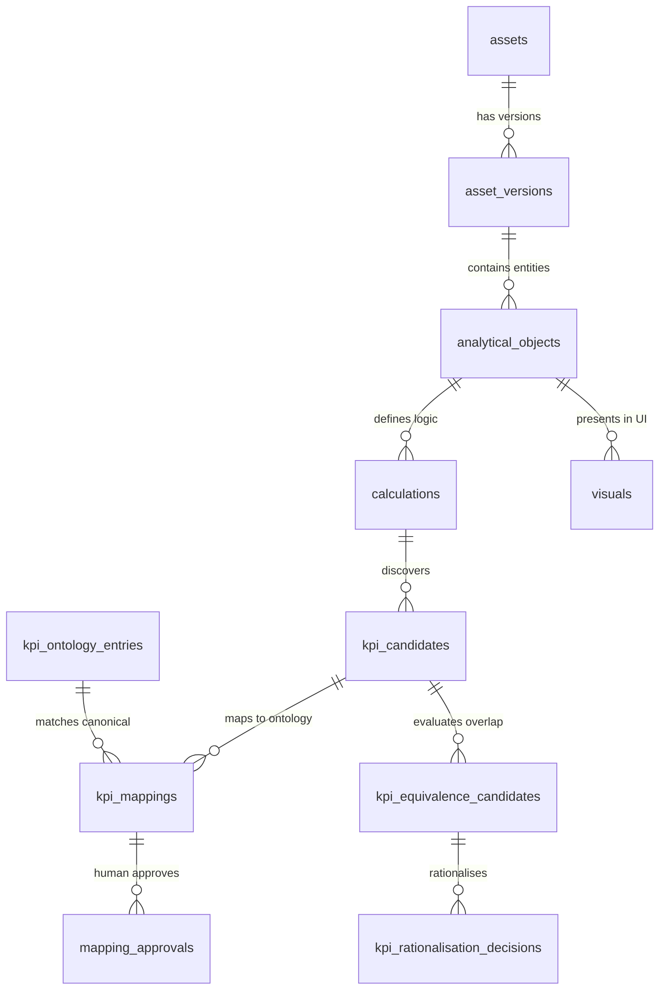
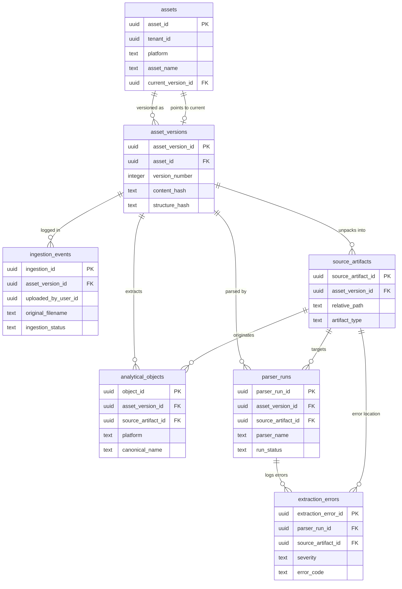
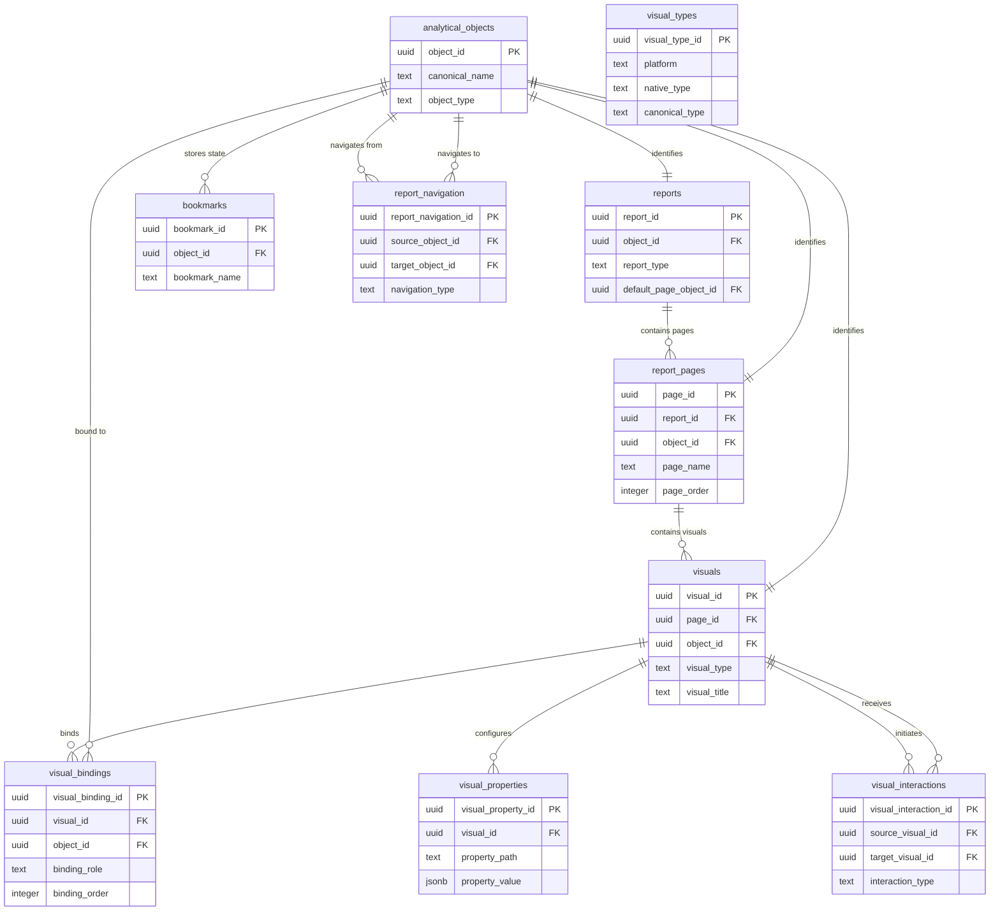
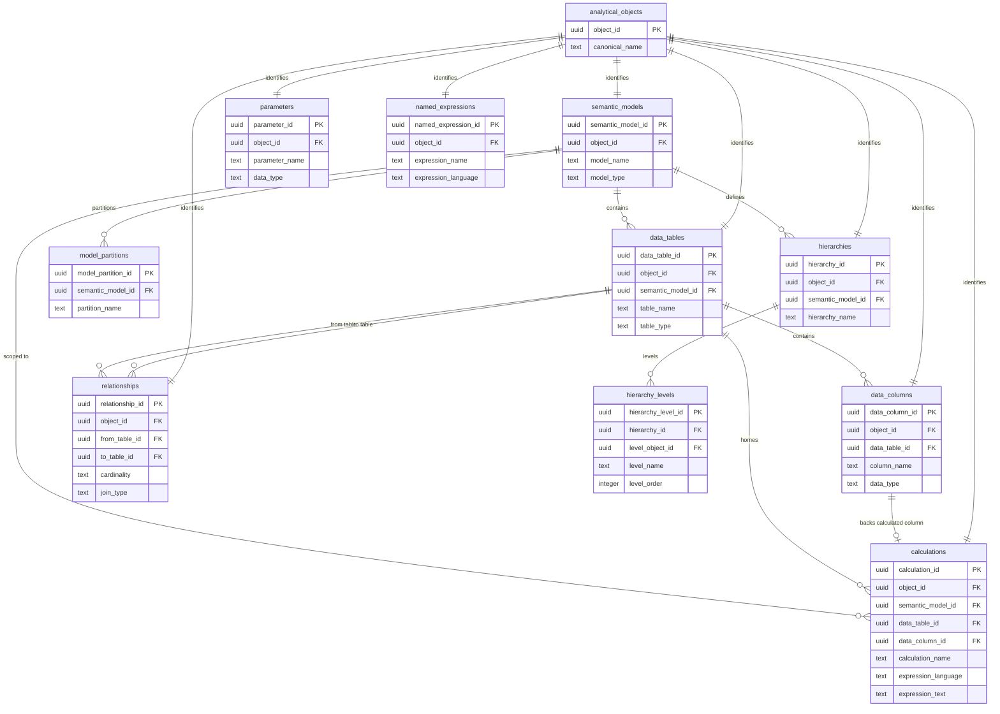
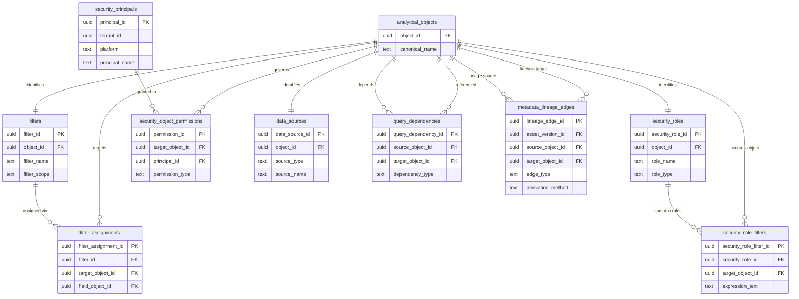
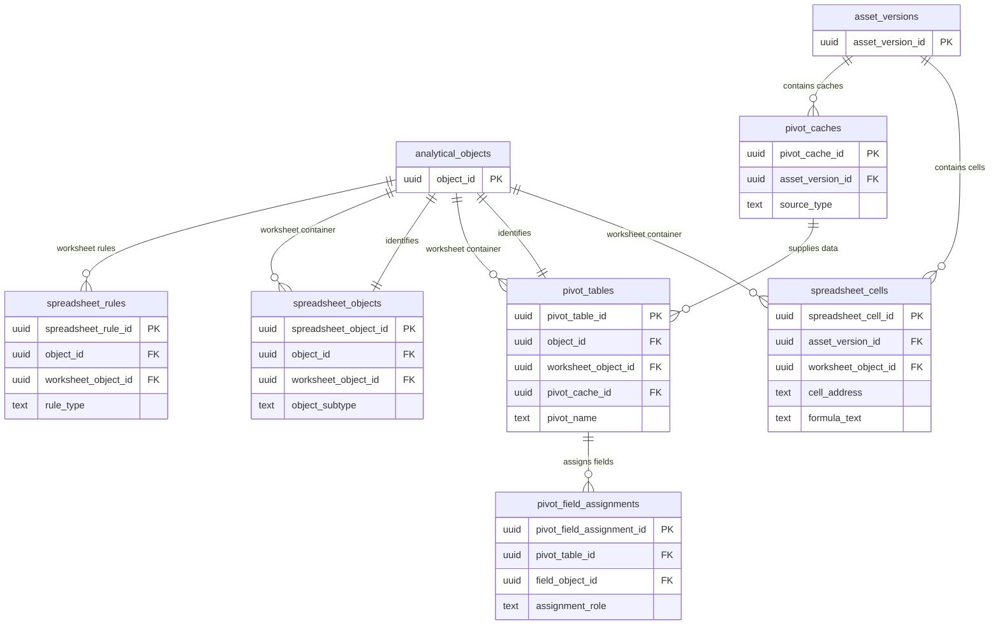
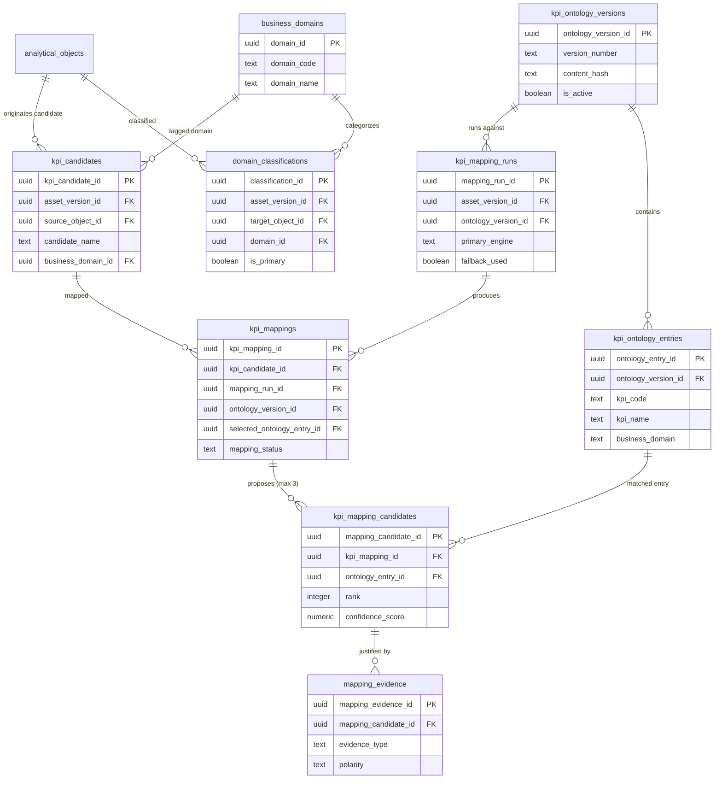
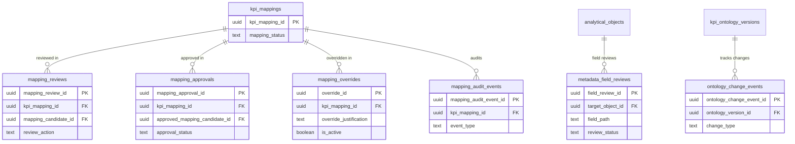
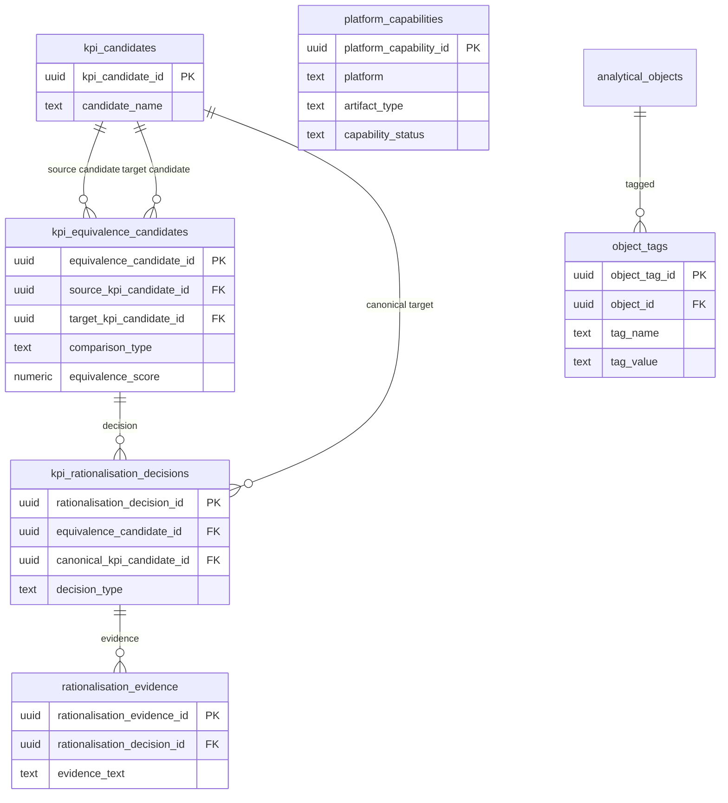

# KPI Intelligence — Canonical Entity-Relationship (ER) Specifications

This document contains the structural data models and entity-relationship specifications for the KPI Intelligence canonical schema (`kpi_intel`). 

To preserve readability, diagrams are decomposed into modular subsystem blocks using standard Mermaid `erDiagram` syntax, followed by detailed cardinality rationales and an exhaustive table-coverage verification map.

---

## 1. High-Level Canonical Architecture Overview

---

## 2. Subsystem ERDs

### ERD 1 — Asset Registry, Ingestion, and Ingestion Audit
Covers physical file intake, version snapshotting, source file tracking, parser execution telemetry, and extraction diagnostics.

*Relationship Rationales*:
- `assets -> asset_versions` ($1:N$): A logical BI asset (e.g. "Underwriting Executive Dashboard") changes over time, producing immutable version records.
- `assets -> asset_versions (current_version_id)` ($1:0..1$): Fast resolution of the active canonical head version.
- `asset_versions -> ingestion_events` ($1:0..N$): A repeat upload of an identical byte stream creates a new upload event without duplicating version metadata.
- `asset_versions -> source_artifacts` ($1:1..N$): Package-based formats (.pbip, .twbx, .zip) unpack into distinct physical source files.
- `parser_runs -> extraction_errors` ($1:0..N$): Any extraction anomalies or syntax parsing failures are logged against the exact execution run.

---

### ERD 2A — Universal Presentation Layer (Reports, Pages, Visuals)
Models user-facing reporting layouts, canvas structures, visual types, field bindings, formatting properties, and visual interactions.

*Relationship Rationales*:
- `analytical_objects -> reports / report_pages / visuals` ($1:1$): Polymorphous canonical identity pattern; every concrete BI entity inherits universal properties (`is_hidden`, `metadata_completeness`, `source_metadata`).
- `visuals -> visual_bindings` ($1:N$): Connects visual components to underlying measures/columns across chart roles (e.g. X-axis, Y-axis, Color, Tooltip).
- `visuals -> visual_interactions` ($1:N$): Cross-filtering and highlighting graph among visual pairs on a canvas.

---

### ERD 2B — Semantic Models, Tables, Columns, and Calculations
Models logical tabular models, entities, attributes, calculation expressions (DAX, M, Tableau, Excel formulas), hierarchies, and joins.

*Relationship Rationales*:
- `semantic_models -> data_tables -> data_columns` ($1:N:M$): Standard relational container hierarchy representing tabular or dimensional schemas.
- `calculations -> semantic_models / data_tables / data_columns`: Calculations may be model-level explicit measures, table-scoped measures, or calculated columns backed by physical column records.
- `relationships -> data_tables` ($N:2$): Captures joins and active model relationships between source and target tables with defined cardinalities (`1:N`, `N:1`, `1:1`, `N:M`).

---

### ERD 3 — Filters, Security, Data Sources, and Dependency Lineage
Captures presentation and model filters, RLS/OLS security roles, principals, data sources, and lineage edges.

*Relationship Rationales*:
- `security_roles -> security_role_filters` ($1:N$): Isolates RLS/OLS policy definitions from standard visual slicing filters.
- `metadata_lineage_edges -> analytical_objects` ($N:2$): Forms a directed metadata graph connecting source databases to tables, calculations, and visuals.

---

### ERD 4 — Excel-Specific Structures
Captures spreadsheet cell coordinates, formulas, cached values, PivotTables, and conditional formatting.

*Relationship Rationales*:
- `pivot_caches -> pivot_tables` ($1:N$): Multiple PivotTable layouts in Excel frequently share a single underlying memory cache or external query.
- `pivot_tables -> pivot_field_assignments` ($1:N$): Fields placed into Row, Column, Filter, or Value areas.

---

### ERD 5 — KPI Ontology and Mapping Engine
Models the local 550+ KPI bank, domain classification, discovery candidates, mapping runs, and ranked candidates.

*Relationship Rationales*:
- `kpi_ontology_versions -> kpi_ontology_entries` ($1:N$): Full versioning of the local JSON ontology bank.
- `kpi_mappings -> kpi_mapping_candidates` ($1:1..3$): Database check constraints strictly limit ranked proposals to at most 3 items (ranks 1, 2, 3).
- `kpi_mapping_candidates -> mapping_evidence` ($1:0..N$): Granular evidence items with explicit polarity (`SUPPORTS`, `CONTRADICTS`, `NEUTRAL`).

---

### ERD 6 — Human Review, Governance Approvals, and Overrides
Models SME reviews, immutable approvals, required override justifications, and audit ledgers.

*Relationship Rationales*:
- `kpi_mappings -> mapping_approvals` ($1:0..N$ with Unique Partial Index): Exactly one active approval is permitted per mapping (`WHERE approval_status = 'APPROVED'`).
- `mapping_overrides -> mapping_overrides (supersedes_override_id)` ($1:0..1$): Forms a self-referencing lineage chain of human override adjustments.

---

### ERD 7 — KPI Rationalisation and Platform Operations
Models cross-asset duplication discovery, human consolidation decisions, and platform capabilities.

---

## 3. Supplementary 61-Table Coverage Verification Map

Every single table in the `kpi_intel` schema appears in the ER diagrams as verified below:

| # | Table Name | Subsystem | Appearing Diagram |
| :--- | :--- | :--- | :--- |
| 1 | `assets` | Subsystem A | High-Level, ERD 1 |
| 2 | `asset_versions` | Subsystem A | High-Level, ERD 1, ERD 4 |
| 3 | `ingestion_events` | Subsystem A | ERD 1 |
| 4 | `source_artifacts` | Subsystem A | ERD 1 |
| 5 | `analytical_objects` | Subsystem B | High-Level, ERD 1, ERD 2A, ERD 2B, ERD 3, ERD 4, ERD 5, ERD 6, ERD 7 |
| 6 | `reports` | Subsystem B | ERD 2A |
| 7 | `report_pages` | Subsystem B | ERD 2A |
| 8 | `visuals` | Subsystem B | High-Level, ERD 2A |
| 9 | `visual_bindings` | Subsystem B | ERD 2A |
| 10 | `visual_properties` | Subsystem B | ERD 2A |
| 11 | `visual_interactions` | Subsystem B | ERD 2A |
| 12 | `visual_types` | Subsystem B | ERD 2A |
| 13 | `bookmarks` | Subsystem B | ERD 2A |
| 14 | `report_navigation` | Subsystem B | ERD 2A |
| 15 | `semantic_models` | Subsystem C | ERD 2B |
| 16 | `data_tables` | Subsystem C | ERD 2B |
| 17 | `data_columns` | Subsystem C | ERD 2B |
| 18 | `calculations` | Subsystem C | High-Level, ERD 2B |
| 19 | `relationships` | Subsystem C | ERD 2B |
| 20 | `model_partitions` | Subsystem C | ERD 2B |
| 21 | `hierarchies` | Subsystem C | ERD 2B |
| 22 | `hierarchy_levels` | Subsystem C | ERD 2B |
| 23 | `parameters` | Subsystem C | ERD 2B |
| 24 | `named_expressions` | Subsystem C | ERD 2B |
| 25 | `filters` | Subsystem D | ERD 3 |
| 26 | `filter_assignments` | Subsystem D | ERD 3 |
| 27 | `security_roles` | Subsystem D | ERD 3 |
| 28 | `security_role_filters` | Subsystem D | ERD 3 |
| 29 | `security_principals` | Subsystem D | ERD 3 |
| 30 | `security_object_permissions` | Subsystem D | ERD 3 |
| 31 | `data_sources` | Subsystem D | ERD 3 |
| 32 | `query_dependencies` | Subsystem D | ERD 3 |
| 33 | `metadata_lineage_edges` | Subsystem D | ERD 3 |
| 34 | `spreadsheet_cells` | Subsystem E | ERD 4 |
| 35 | `pivot_caches` | Subsystem E | ERD 4 |
| 36 | `pivot_tables` | Subsystem E | ERD 4 |
| 37 | `pivot_field_assignments` | Subsystem E | ERD 4 |
| 38 | `spreadsheet_objects` | Subsystem E | ERD 4 |
| 39 | `spreadsheet_rules` | Subsystem E | ERD 4 |
| 40 | `kpi_ontology_versions` | Subsystem F | ERD 5, ERD 6 |
| 41 | `kpi_ontology_entries` | Subsystem F | High-Level, ERD 5 |
| 42 | `business_domains` | Subsystem F | ERD 5 |
| 43 | `domain_classifications` | Subsystem F | ERD 5 |
| 44 | `kpi_candidates` | Subsystem G | High-Level, ERD 5, ERD 7 |
| 45 | `kpi_mapping_runs` | Subsystem G | ERD 5 |
| 46 | `kpi_mappings` | Subsystem G | High-Level, ERD 5, ERD 6 |
| 47 | `kpi_mapping_candidates` | Subsystem G | ERD 5 |
| 48 | `mapping_evidence` | Subsystem G | ERD 5 |
| 49 | `mapping_reviews` | Subsystem H | ERD 6 |
| 50 | `mapping_approvals` | Subsystem H | High-Level, ERD 6 |
| 51 | `mapping_overrides` | Subsystem H | ERD 6 |
| 52 | `metadata_field_reviews` | Subsystem H | ERD 6 |
| 53 | `kpi_equivalence_candidates` | Subsystem I | High-Level, ERD 7 |
| 54 | `kpi_rationalisation_decisions`| Subsystem I | High-Level, ERD 7 |
| 55 | `rationalisation_evidence` | Subsystem I | ERD 7 |
| 56 | `platform_capabilities` | Subsystem J | ERD 7 |
| 57 | `parser_runs` | Subsystem J | ERD 1 |
| 58 | `extraction_errors` | Subsystem J | ERD 1 |
| 59 | `object_tags` | Subsystem J | ERD 7 |
| 60 | `mapping_audit_events` | Subsystem J | ERD 6 |
| 61 | `ontology_change_events` | Subsystem J | ERD 6 |
